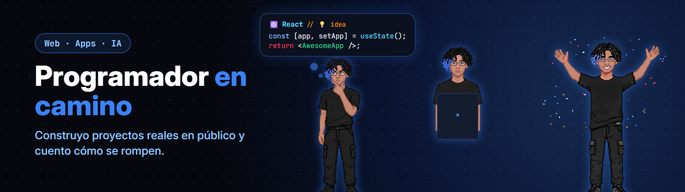

  

# 👋 ¡Hola! Soy Franyel Pacheco

Construyo proyectos reales en público, rompo código y aprendo en el camino.

## 🚀 Proyectos en Producción
- 📱 **[Pa' que sufras](https://play.google.com/store/apps/details?id=com.franyel_pacheco.paquesufras)**: Party game móvil de tensión social con +750 cartas.  
  `React Native` · `Expo` · `Reanimated` · `TypeScript` → [Google Play](https://play.google.com/store/apps/details?id=com.franyel_pacheco.paquesufras) · [Código](https://github.com/FranyelPacheco/Pa-que-sufras)

- 🎮 **[Impostor Royale](https://play.google.com/store/apps/details?id=com.impostor.royale)**: Deducción social offline (*Pass & Play*) para 3 a 10 jugadores en un solo teléfono.  
  `React Native` · `Expo` · `TypeScript` → [Google Play](https://play.google.com/store/apps/details?id=com.impostor.royale)

- 🌐 **[Portafolio Web](https://mi-portafolio-seven-psi.vercel.app)**: Web personal interactiva con efectos HyperText, filtrado de proyectos y modo oscuro.  
  `React 19` · `Tailwind CSS` · `TypeScript` · `Vite` → [Web en Vivo](https://mi-portafolio-seven-psi.vercel.app) · [Código](https://github.com/FranyelPacheco/mi-portafolio)

## 🛠️ Tecnologías y Herramientas

  

## 📬 Contacto y Redes

---
> *Hoy programamos bien, pero mañana lo haremos mejor.*
